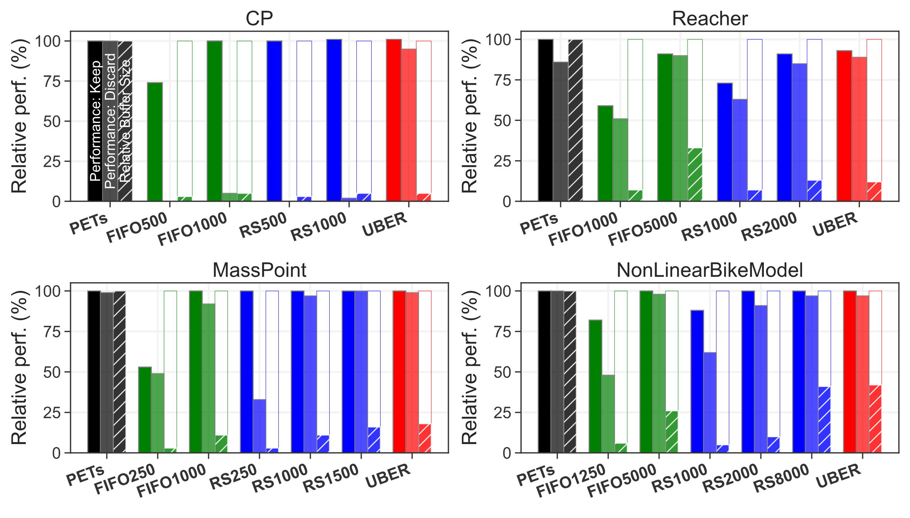
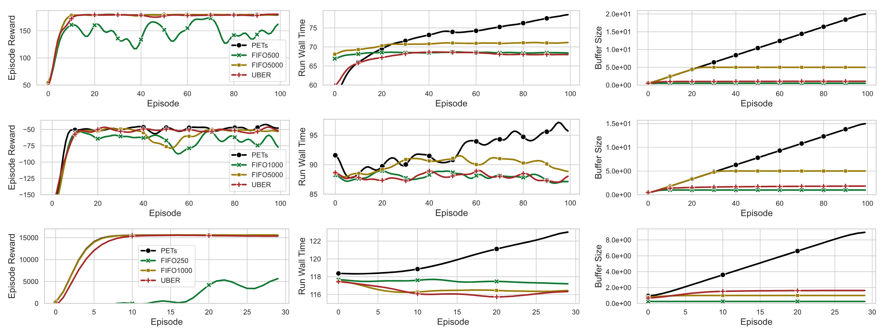

# UBER：用计划失准筛选值得留下的经验

智能体在相似任务上长期运行，会不断收集重复经验；全部保存增加训练开销，固定容量又可能挤掉旧知识。UBER 用动力学模型检查：看到真实状态后，继续执行原计划的预期奖励是否仍与最初预测一致。偏差较大时，它重新规划并保存刚发生的转移；偏差较小时继续原计划，省去这次入库。再配合“新增经验足够才训练”，它尝试让存储和计算随着新信息增长，在相似任务序列中用较少经验维持控制能力。[P0，§5](https://openreview.net/forum?id=WxHTSPS2pi)

## 论文来源

| 项目 | 信息与来源 |
| --- | --- |
| 发表刊物与状态 | **Transactions on Machine Learning Research（TMLR），2025，正式期刊论文**；[TU Graz 机构记录](https://tugraz.elsevierpure.com/en/publications/uncertainty-based-experience-replay-for-task-agnostic-continual-r/) |
| 最早公开时间 | 确切首发日未核实；[TMLR 2024-10-05 官方通告](https://groups.google.com/g/tmlr-announce-daily/c/N98tJCmP0N8)已列本文，可确认至迟该日已公开 |
| 正式发表时间 | **2025-02**；机构记录与 PDF 页眉一致，保留月精度 |
| 所读版本与原文 | TMLR 02/2025 发表版，26 页，含附录；[OpenReview](https://openreview.net/forum?id=WxHTSPS2pi)、[正式 PDF 入口](https://openreview.net/pdf?id=WxHTSPS2pi) |
| 官方代码 | 已查论文及作者公开仓库，未核实到对应实现；作者的 [aui](https://github.com/dasGringuen/aui) 对应前作，不能当作 UBER 代码 |
| 项目主页 | 未核实到独立项目主页 |

历史动机暂以 2024-10-05 为边界，最早版本时间轴仍有缺口；后续文献核查截至 **2026-10-12**。笔记覆盖全文与附录，涉及解释的公式和关键图表已对照原页面；原文的指标与伪代码缺口在相应位置说明。

## 1. 研究问题、背景与价值

设想赛车先练直道和几个弯道，再逐渐学习完整赛道。模型强化学习把每次“状态、动作、下一状态”作为训练数据，学习车辆如何响应控制，再用模型搜索高回报动作。相似路段重复经过，数据会持续增加；训练也不断重看这些记录。若简单地只保留最近一批，早期少见的转弯经验又可能被清掉。

本文要解决的是**未知任务边界下的经验接纳与计算分配**：智能体不知道何时换任务，也不预先知道需要多大的回放库，能否根据自己的预测能力决定哪些新经验值得保存？实际验证主要是低维状态输入、相同系统上改变赛道几何的任务序列；训练对象是动力学模型，动作由规划器产生。[P0，§3、§6、§8](https://openreview.net/forum?id=WxHTSPS2pi)

## 2. 从前人工作，怎样走到这个 idea

**先看旧机制为什么有效。** PETS 用多个概率动力学网络预测状态变化，通过粒子轨迹估计候选动作的回报。真实经验不断训练模型，使未来规划更可靠。概率预测也提供了观察计划可信程度的基础。[P1](https://arxiv.org/abs/1805.12114)

**持续学习使“保存多少”成为独立问题。** 旧数据参与训练，可以维持先前能力；但保存得多并不自动等于训练得好。Zhang 与 Sutton 已指出回放容量需要调节，大容量也可能损害学习。Isele 与 Cosgun 比较过惊讶度、奖励、全局分布匹配和状态覆盖等保留方式，其中分布匹配在其任务上表现稳健。这说明记忆需要兼顾历史覆盖，最近或最令人惊讶的数据不能天然代表全部重要经验。[P2](https://arxiv.org/abs/1712.01275)、[P3](https://arxiv.org/abs/1802.10269)

由此产生的要求是：在新数据进入长期记忆前，判断它相对于模型已经掌握的行为增加了什么。单纯按时间或随机保留，无法直接利用“模型能否预见这次经历”的信息；而基于模型的控制恰好已经有预测器和真实执行反馈，不必另外训练一个任务识别器。

**已有的计划可靠性检查提供了接口。** Remonda 等人的前作研究何时可以继续执行旧计划。2021 年版本已讨论利用真实状态向前预测剩余动作；2024-07 的版本明确给出 BICHO，通过比较剩余计划的奖励分布决定是否重规划。它让一个状态偏差转化为“这会不会改变接下来控制效果”的信号。[P4，v1 §7；v6 §5](https://arxiv.org/html/2105.05716v6)

由这些机制可以提出一个候选：如果某次经历已经使原计划的未来效果失准，这条真实转移也可能有助于修正模型；如果预测一直吻合，重复保存的价值可能较低。UBER 将这个信号从重规划扩展到经验接纳，并协调训练频率。PETS 和 BICHO 是其基础，本文的关键改动是这些决策的衔接；计划失准能否代表长期学习价值，仍需要实验检验。[P0，§5](https://openreview.net/forum?id=WxHTSPS2pi)

## 3. 核心 intuition

UBER 把“这次经历值得记住”与“它迫使我改变对后续结果的预期”联系起来。模型越熟悉当前行为，触发入库的次数就应越少，历史记录也较少被重复经验淹没。这个联系依赖奖励预测能够暴露有用的新信息，尤其依赖当前任务重视的内容与未来任务存在足够重叠。

## 4. 方法与一个简单例子

**本文使用三个功能模块，只有动力学模型需要从经验中学习。** 动力学模型预测“做这个动作后会发生什么”，任务给定的奖励函数评价“结果有多好”，规划器搜索“接下来做哪些动作”。这里没有单独训练的 actor、critic 或奖励网络。动力学模型由多个概率神经网络组成，输入状态与动作，预测状态变化的分布；因此，同一个动作计划可以对应多种未来状态及奖励。[P0，§3.1，第4–6页](https://openreview.net/forum?id=WxHTSPS2pi)

**① 先搜索一串动作，并保留对后续奖励的预测。** 初始经验来自随机控制。规划器反复提出候选动作序列，用动力学模型模拟状态变化，再用奖励函数计算预测累计奖励；CEM 根据高分候选调整动作采样分布，逐轮改进计划。选好计划后，记下后续奖励的预测分布 $p_r^{\mathrm{旧}}$。动力学模型从搜索阶段就参与计算，并非选完动作才调用。

**② 真实执行第一个动作，从真实结果出发重新预测。** 设当前状态为 $s_0$，计划前两个动作为 $a_0,a_1$。原来预测的路径是 $s_0\xrightarrow{a_0}\hat s_1\xrightarrow{a_1}\hat s_2$。真实执行 $a_0$ 后，得到实际状态 $s_1$，再从它出发模拟原来的 $a_1$，得到新预测 $\tilde s_2$。

此时，**模型参数没更新，剩余动作没改变，只把模拟起点换成真实观测。** 奖励函数给新的预测结果打分，得到 $p_r^{\mathrm{新}}$。比较时要对齐同一个未来时刻：例如两份预测都回答“执行完 $a_1$ 后会获得怎样的奖励”。这区别于直接比较执行 $a_0$ 的预测奖励和实际奖励。[P0，§5、算法3–4，第8–9页](https://openreview.net/forum?id=WxHTSPS2pi)

**③ 预测变化大就保存刚才的真实经验，并重新规划。** 计算两份奖励分布的 Wasserstein 距离：

$$
u=W\!\left(p_r^{\mathrm{新}},p_r^{\mathrm{旧}}\right).
$$

若 $u>\beta$，把刚才的真实转移 $(s_0,a_0,s_1)$ 放进 replay buffer，并在下一步行动前重新搜索动作计划；否则跳过这条经验的入库，继续原计划。两种情况下都读取了真实状态；想象轨迹不会因此进入训练集。

用小车过弯说明：原来预测轻刹并左转后速度从 8 降到 6，实际却只降到 7.5。于是从实际状态出发，重新模拟剩下的转弯动作。下面将某个对齐未来时刻的奖励分布简化为单点分布，设 $\beta=1$；全部数字均为教学示意。

| 情况 | 原来的奖励预测 | 从真实状态重新预测 | 距离 | 处理 |
| --- | ---: | ---: | ---: | --- |
| 车辆基本按预期前进 | 10 | 9.8 | 0.2 | 不入库，继续计划 |
| 车辆减速不足，后续效果变差 | 10 | 6 | 4 | 保存真实转移，下一步重规划 |

**④ 新数据积累够了，再训练动力学模型。** 新增经验数超过当前库大小的某个比例后，设置训练标志，在后续外层迭代开始时用库内新旧经验更新网络。奖励预测差异决定“数据是否留下”；训练目标则来自“真实状态怎样变化”。上例中，真实速度变化是 $7.5-8=-0.5$，模型原预测为 $6-8=-2$，训练让模型有机会修正这类响应。例如当前库有100条、自上次训练后新增11条，若教学设定的比例为10%，则 $11>0.1\times100$，触发下一轮训练；10%并非论文给出的实验值。触发入库并不意味着即时更新网络。[P0，算法3、附录§12，第9、23页](https://openreview.net/forum?id=WxHTSPS2pi)

**计划有多长，检查多远？** CartPole、Reacher、Masspoint 的规划长度均为 $H=25$，表2的 look-ahead（LA）均为1；搜索未来25步，不代表每次检查全部25步。MPD 进一步限制预测距离，避免把长轨迹末端不可避免的重规划都当成新知识。原文算法4以 $L=\min(H,\mathrm{LA}-i,\mathrm{MPD})$ 限制比较范围，其中 $i$ 记录计划已推进的步数；窗口耗尽的边界、奖励分布估计与跨时间聚合未完整交代，新增比例的具体值、训练标志及计数重置也未写全。Bike 的 $H$ 未明确列出。[P0，附录§11–13，第22–24页](https://openreview.net/forum?id=WxHTSPS2pi)

UBER 没有显式删除旧经验，也没有硬容量上限；库较小来自减少接纳。重新预测改变模拟起点，重新规划改变动作计划，模型训练才改变网络参数。Bike 实现另结合已知车辆运动学：网络学习动力学响应，再更新位置和朝向，因此并非完全从数据学习所有运动关系。[P0，§8、附录§13.4](https://openreview.net/forum?id=WxHTSPS2pi)

## 5. 实验：问题、关键数据与结论

### 对照方法如何管理经验？

这些方法都围绕真实转移管理回放数据，主要区别是保存规则与需要的先验信息。

| 方法 | 数据如何保留 | 容量与任务信息 |
| --- | --- | --- |
| PETS | 保留全部真实转移 | 库随交互增长 |
| Scratch | 每次换任务清空模型参数和经验，重新训练 | 需要知道任务切换 |
| FIFO | 只保留最近的 $K$ 条，先删除最早数据 | 固定容量，无需任务边界 |
| A-FIFO | 按已见任务数 $T$ 分配每任务约 $K/T$ 条，各任务内部 FIFO | 固定总容量，需要任务划分 |
| RS（reservoir sampling，蓄水池采样） | 从整个历史数据流中均匀保留 $K$ 条 | 固定容量，无需任务边界或数据流总长度 |
| UBER | 奖励预测偏差超阈值时接纳，已保留数据继续留存 | 容量随接纳次数增长，无需任务边界 |

标准 RS 先保存前 $K$ 条；第 $n>K$ 条到来时，以 $K/n$ 的概率接纳，接纳后随机替换库中一条。这样，处理完 $n$ 条后，每条历史记录被保留的概率都是 $K/n$。均匀的是历史记录，出现频繁的状态仍会占更多期望份额。UBER 则尝试偏向模型尚难预见的经历；这依赖分数能识别长期有用的数据。论文没有充分给出其 RS 实现与短期记忆混合的细节，上述说明采用标准蓄水池机制。[P0，§3.2](https://openreview.net/forum?id=WxHTSPS2pi)、[P3](https://arxiv.org/abs/1802.10269)、[P8，§2](https://www.ittc.ku.edu/~jsv/Papers/Vit85.Reservoir.pdf)

### 少存经验后，能否保持控制性能？

Masspoint 共有 8 个 EASY 路段、3 个 MID 路段和3个 HARD 完整赛道。每任务训练30个 episode，每个测试任务评估1个 episode；§7报告每组超参数运行3次，改变随机种子和初始条件。下表按原表摘录，未报告可配套的标准差或置信区间，微小差异不宜作显著性判断。

| 方法 | EASY+MID→HARD 库大小（条）↓ | 相对性能（%）↑ | ALL→ALL 库大小（条）↓ | 相对性能（%）↑ |
| --- | ---: | ---: | ---: | ---: |
| PETS | 37,150 | 100.0 | 97,150 | 100.0 |
| FIFO 20k | 20,000 | 99.9 | 20,000 | 96.5 |
| A-FIFO 1000 | 1,000 | 98.5 | 1,000 | 100.1 |
| RS 500 | 500 | 98.0 | 500 | 99.4 |
| RS 1000 | 1,000 | 99.4 | 1,000 | 99.4 |
| UBER，$\beta=1.4$ | 966 | 93.4 | 1,558 | 99.4 |
| UBER，$\beta=1.1$ | 1,390 | 99.6 | 1,698 | 99.4 |
| UBER，$\beta=0.9$ | 1,942 | 100.0 | 2,303 | 99.3 |

来源：[P0，第13–14页，图5](https://openreview.net/forum?id=WxHTSPS2pi)。基础指标为每回合累计奖励除以“最高速度×任务步数”；单步奖励 $r=V(1-|\rho|)$，结合车速与路径偏差。原表再将 PETS 列为100，报告其他方法的相对性能，但第二步转换及汇总细节不完整。**99.4表示回报指标接近 PETS，不能读成99.4%的成功率。** 前一协议是在11个路段训练后测试3个未训练整圈赛道，后一协议在全部14项训练后测试全部任务。

UBER 在 ALL→ALL 用 $1698/97150\approx1.75\%$ 的经验量取得99.4的相对性能，说明全量保存包含大量可削减的数据。但 **RS500 用500条也达到99.4，所需存储约为该 UBER 配置的三分之一**。在这组结果里，RS 的性能与存储取舍更好。UBER 的特点是让接纳数量随预测偏差变化，不必预设固定库大小；阈值仍需调节，不能据此推成容量自动最优。减少保留数据也不等于减少环境交互次数。

原文图5的 EASY→HARD 数字列与上方曲线、正文严重不符，例如 UBER $\beta=1.1$ 被列为6.8，曲线却接近 PETS；这里不采用该列，也不自行修正。正文部分存储比例与表格不一致，上面的1.75%由已列数字重算。

### 更复杂车辆任务中，这个取舍还成立吗？

Bicycle 有9个 EASY 路段和3个 HARD 整圈赛道。下表为全部12项训练后测试3个 HARD 的结果，**这些 HARD 已经参加训练**。训练、测试回合数及3次运行协议同上。

| 方法 | 库大小（条）↓ | 原表归一化性能分数（%）↑ |
| --- | ---: | ---: |
| PETS | 80,752 | 100 |
| FIFO 25k | 25,000 | 58 |
| RS 5000 | 5,000 | 59 |
| RS 10000 | 10,000 | 100 |
| UBER，$\beta=5\times10^{-4}$ | 5,767 | 95 |
| UBER，$\beta=1.5\times10^{-4}$ | 14,412 | 99 |
| UBER，$\beta=10^{-4}$ | 27,773 | 100 |

来源：[P0，第15–16页，图7](https://openreview.net/forum?id=WxHTSPS2pi)。作者依据完成时间定义 $p=1-(T-T_{\mathrm{PETS}})/\mathrm{max\_delta}$，表中报告 $100p$；`max_delta` 的取值范围与参考运行说明不足。这些数字是表内归一化分数，不能读成成功率或速度比例。

较小预算附近，UBER 的5,767条/95分明显好于 RS 的5,000条/59分，但二者并非严格同容量。容量增加后，RS10000 比 UBER 的14,412条配置存得更少、得分更高。结合 Masspoint，结果支持 UBER 能压缩全量经验，同时也表明 **RS 是很强的基线，UBER 没有普遍胜出**。如果系统要求固定内存上限，RS 可直接满足，UBER 的现有接纳机制没有这一保证。

真正的 EASY→HARD 泛化中，正文明确承认 UBER 不够稳健，原表列出 UBER 各配置25–40、RS10000为91；考虑该列也存在图表不一致，仅据此保留“选择性记忆可能损害跨任务泛化”的方向性判断。

### 保留的数据是否足以重新学会，计算为何减少？

图3先训练到收敛，保留库、丢弃网络参数，再仅用库中数据重新训练。UBER 的性能降幅较小，说明知识不只存在于旧参数中，压缩后的经验仍能支持重学；该图没有精确数字表。

*图3｜保留经验是否足以重新学习。每种方法的三根柱从左至右分别为：保留训练后参数的测试性能（Keep）、丢弃参数后仅用保留经验重新训练的测试性能（Discard）、回放库大小。前两者为相对 PETS 的性能百分比，第三者为相对 PETS 的库大小百分比；前两柱越接近，说明保留数据越能支持重新学习。[来源：P0，第11页，图3](https://openreview.net/forum?id=WxHTSPS2pi)。*

图2展示重复单任务训练时，UBER 的库增长和每回合耗时趋缓。

*图2｜重复单任务训练中的性能、耗时与存储变化。三行从上到下为 CartPole、Reacher、Masspoint；三列从左到右为每回合回报、每回合实际耗时（秒）、回放库规模（刻度沿用原图）。横轴均为训练回合数。中间列包含整个回合的耗时，不能读成单独的模型训练时间；本图未包含 RS。[来源：P0，第7页，图2](https://openreview.net/forum?id=WxHTSPS2pi)。*

这些结果支持数据筛选和资源节省，但减少重规划、减少入库与按需训练没有被充分分开消融。图2没有 RS 的耗时曲线，其他图也没有在相同收益或存储预算下给出直接耗时对照，因此不能声称 UBER 比 RS 更快。遗忘图6还存在公式与曲线的符号、汇总单位说明不一致，因此不把其数值重述为明确的遗忘百分比。较稳妥的判断来自最终旧任务性能和重学实验。

## 6. Take-aways

1. **可以复用控制过程产生的反馈管理训练数据。** 计划与现实的偏差同时影响下一步行动和长期学习，为两套决策提供共同信号。
2. **压缩记忆应检查能否重学。** 丢弃网络权重再训练，比仅测当前策略更能检验保留数据承载了多少知识。
3. **自动接纳数量与最优存储量是两个目标。** 本文展示前者的可行性；阈值仍需调节，RS 仍是必须认真比较的强基线。

## 7. 比较脆弱的假设

**奖励预测的变化能代表长期学习价值。** 这个假设可能同时造成漏存和多存。下面的例子用于分析机制，论文没有通过相应实验定位这些失败：

- **短期奖励相同，长期后果可能不同。** 迷宫中只有到达终点才有奖励；模型预计进入正确通道，实际却滑入另一条通道。若比较窗口内两边奖励都为0，分数可能很小，但几步之后的可达性已不同。若状态差异对所有相关控制结果始终无关，跳过它是合理的；风险来自当前窗口掩盖了以后重要的差异。
- **同一个模型可能两次都犯同样的错。** 若模型一直低估刹车距离，从预测位置和真实位置出发，它都可能乐观地认为车辆能停在障碍物前。真实观测提供了反馈，但未来仍由同一模型推演；两次预测一致只能说明内部一致，不能保证准确。
- **看到随机结果，也会改变预测。** 假设模型已准确掌握随机风的分布，执行前预测包含向左、向右两种可能；观察到车确实被吹向右侧后，新的条件预测自然改变。调整当前计划可能有价值，但这条数据对学习风的规律未必还有很高的边际价值。有限数据仍可帮助校准概率和覆盖罕见情况，不能把噪声样本一概视为无用。高方差本身也不等于高分：两次分布相同，距离仍为0。UBER 的概率集成可以表示不同不确定性，但入库分数没有显式提取可通过学习减少的部分。
- **固定阈值受奖励尺度影响。** 按标准 Wasserstein 距离，奖励统一乘正数 $c$，分数也乘 $c$。例如原分数0.02、阈值0.1时跳过，奖励乘100后分数变成2；同一次物理经历就会被接纳。要保持同样的判断，阈值也应同步调整。

因此，需要调整当前动作、模型尚未学会规律、经验值得长期保存，这三者之间仍有距离。上述机制可以提出 RS 在某些情况下更强的可能解释，但论文没有验证其为实验差异的实际原因。

**新任务主要复用旧的动力学知识。** 论文任务大多改变路径几何，作者明确没有测试相互冲突的动力学。若同一状态与动作在不同隐藏条件下产生不同结果，混在一个无条件模型和旧经验库里训练，可能持续互相干扰；入库更多数据本身无法解决这个表示问题。[P0，§8](https://openreview.net/forum?id=WxHTSPS2pi)

**预测变准后，新信息到达率会下降。** 在反复出现的相似任务上，这可以让库增长趋缓；持续遇到陌生情况时，UBER 仍会不断接纳数据。论文将有限容量下“该忘掉什么”列为后续工作，所以现有结果不能推出无限任务流下的内存上界。

## 8. Follow-up：把入库依据从奖励偏差推进到决策变化

一个值得研究的候选是：检查真实观测是否改变了**多个候选动作的优劣排序**，据此决定是否保存转移。UBER 只看已选计划的奖励变化；如果该计划的奖励变化很小，但另一个动作已更值得选择，当前筛选可能漏掉这种经验。候选机制可复用规划时的动作集合，研究一条新经验是否纠正了可重复出现的决策错误，降低短期奖励相同造成的盲区。

截至本次检索，近邻已有不同进展：UPER（2025）用认知与偶然不确定性之比形成信息增益，改变库内采样优先级；ARROW（2026）用近期 FIFO 和长期 reservoir 维持世界模型的记忆；UDRM（2026）在所有转移先存一次的基础上，对高认知不确定性且正奖励的转移重复存储。这些结果使“加入不确定性或长期记忆”本身不足以构成新贡献。[P5](https://arxiv.org/html/2506.09270v1)、[P6](https://arxiv.org/html/2603.11395v3)、[P7](https://arxiv.org/html/2608.29860v1)

候选方向需要验证的区别是：在原计划奖励接近、备选动作排序却变化的情境中，能否以相同存储预算更快纠正后续决策。它目前只是与上述近邻有明确比较对象的研究设想，尚不能确认原创性。

## 参考来源

- **P0** Adrian Remonda、Cole Terrell、Eduardo Veas、Marc Masana. *Uncertainty-Based Experience Replay for Task-Agnostic Continual Reinforcement Learning*. TMLR，2025-02，1–26页。[论文入口](https://openreview.net/forum?id=WxHTSPS2pi)。全文依据用户提供的发表版 PDF；书目信息另由来源表中的官方通告和机构记录核实。
- **P1** Kurtland Chua、Roberto Calandra、Rowan McAllister、Sergey Levine. *Deep Reinforcement Learning in a Handful of Trials using Probabilistic Dynamics Models*. NeurIPS 2018。[论文记录](https://arxiv.org/abs/1805.12114)。概率集成与粒子规划背景。
- **P2** Shangtong Zhang、Richard S. Sutton. *A Deeper Look at Experience Replay*. arXiv:1712.01275，2017，所查v3修订于2018。[论文记录及摘要](https://arxiv.org/abs/1712.01275)。用于容量影响的背景判断。
- **P3** David Isele、Akansel Cosgun. *Selective Experience Replay for Lifelong Learning*. AAAI 2018。[论文记录及摘要](https://arxiv.org/abs/1802.10269)。用于选择策略及历史分布覆盖背景。
- **P4** Adrian Remonda、Eduardo Veas、Granit Luzhnica. *Acting upon Imagination: When to Trust Imagined Trajectories in Model Based Reinforcement Learning*. [2021-05-12 v1](https://arxiv.org/html/2105.05716v1)、[2024-07-30 v6](https://arxiv.org/html/2105.05716v6)。查阅计划可靠性与BICHO相关章节；v1没有完整BICHO算法，v6使用KL距离，UBER改用Wasserstein距离。
- **P5** Rodrigo Carrasco-Davis、Sebastian Lee、Claudia Clopath、Will Dabney. *Uncertainty Prioritized Experience Replay*. 2025-06-10，arXiv:2506.09270v1。[正文](https://arxiv.org/html/2506.09270v1)。查阅不确定性分解与采样机制。
- **P6** Abdulaziz Alyahya、Abdallah Al Siyabi、Markus R. Ernst、Luke Yang、Levin Kuhlmann、Gideon Kowadlo. *ARROW: Augmented Replay for RObust World models*. 首发2026-03-12，所查v3为2026-06-11。[正文](https://arxiv.org/html/2603.11395v3)。查阅世界模型持续学习及双缓冲区机制。
- **P7** Sheeraja Rajakrishnan、Alexander G. Ororbia、Travis Desell、Daniel E. Krutz. *Uncertainty-Driven Replay Memory for Reinforcement Learning*. 2026-08-30，arXiv:2608.29860v1。[正文](https://arxiv.org/html/2608.29860v1)。查阅不确定性估计、算法1及与UBER的关系。
- **P8** Jeffrey S. Vitter. *Random Sampling with a Reservoir*. ACM Transactions on Mathematical Software，11(1)，37–57，1985。[作者提供的论文](https://www.ittc.ku.edu/~jsv/Papers/Vit85.Reservoir.pdf)、[DOI](https://doi.org/10.1145/3147.3165)。标准蓄水池采样机制来源。
